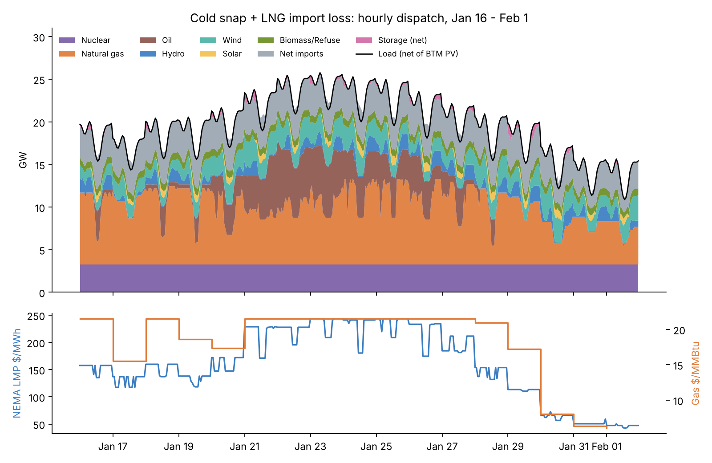
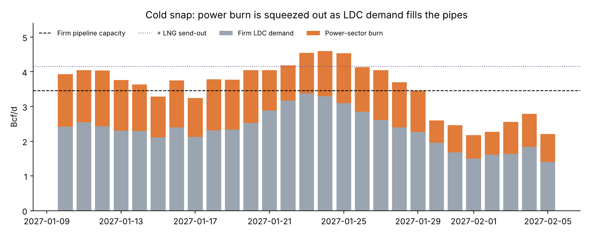
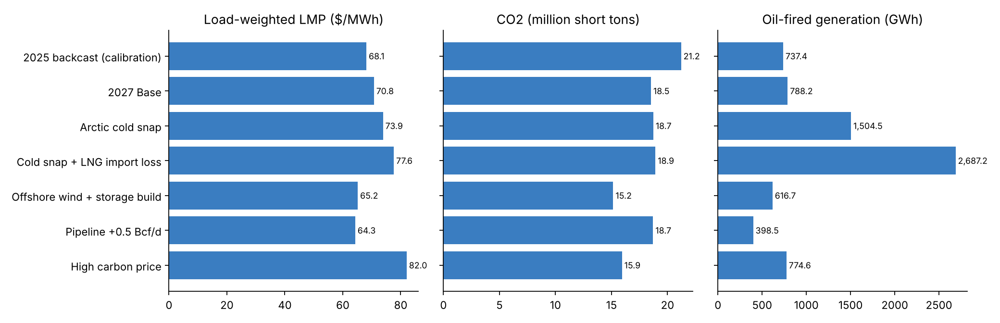

# New England Gas-Electric Production Cost Model

**A chronological unit-commitment and economic-dispatch model of ISO New England, co-optimized with the New England natural gas system.**
Built from first principles in Python with the open-source HiGHS MIP solver to reproduce the simulation logic of commercial power-market tools such as **PLEXOS, PROMOD and AURORA**, with an integrated gas layer in the spirit of PLEXOS gas-electric co-optimization.

*Author: Cathy Kam* · **[Live app](https://ne-gas-power-pcm.streamlit.app)**

---

## Why this model

New England's power prices are set by natural gas, and in winter the gas price is set by
**pipeline scarcity**: firm heating (LDC) customers fill the interstate pipes first, and
generators bid for what is left, switch to oil, or rely on LNG. Most power models treat gas as an
exogenous price. This model makes the citygate gas price **endogenous**, so the same optimization
that commits and dispatches the fleet also clears the gas market each day.

## What it does

* **365-day rolling-horizon simulation**: each day is a 36-hour MIP (24 h committed + 12 h look-ahead), with unit status, ramp state, storage state of charge and oil inventory carried forward.
* **Unit commitment**: ~40 clustered unit groups with integer commitment, start costs, min up/down, ramp limits and no-load + incremental heat-rate curves.
* **Dual-fuel operation**: gas or oil mode per hour, oil derate, on-site oil inventory with refill.
* **Integrated gas market**: daily gas balance (firm LDC demand + power burn) against a stepwise Algonquin-citygate supply stack: pipeline basis bands, LNG send-out, LDC peak-shaving. The shadow price is the daily citygate gas price.
* **8 ISO-NE load zones** with transmission limits and the North-South, Boston Import, SEMA/RI Export and CT Import interfaces.
* **Market prices** from an LP re-solve with commitment fixed (standard PCM practice), with **fast-start pricing** for quick-start peakers as ISO-NE does.
* 30-minute operating reserves with an RCPF-style shortage price; pumped hydro, batteries, hydro energy budgets; Quebec, New Brunswick and New York interchange.

See [docs/methodology.md](docs/methodology.md) for the full formulation and a **PLEXOS/PROMOD crosswalk**.

## Calibration: 2025 backcast

| Metric | Model (2025 backcast) | ISO-NE reported, 2025 |
|---|---|---|
| Average energy price | $68.1/MWh (load-weighted) | $71.8 day-ahead / $65.9 real-time |
| Average New England gas price | $6.80/MMBtu | $6.27/MMBtu |
| Net energy for load | 118 TWh | ~118 TWh (implied by IMM cost per MWh) |

Reported figures: ISO-NE External Market Monitor, 2025 annual report (summarized by ISO Newswire, June 2026).
The backcast uses an approximate 2025 Henry Hub strip and weak Quebec imports, consistent with 2025 conditions.

## Scenario results (2027 study year, same weather year in every case)

| Scenario | Load-wtd LMP ($/MWh) | Avg gas ($/MMBtu) | Winter gas | Energy cost ($B) | CO2 (Mt) | Oil gen (GWh) | Cold-week LMP | Cold-week oil share |
|:--|--:|--:|--:|--:|--:|--:|--:|--:|
| 2025 backcast (calibration) | 68.14 | 6.80 | 13.09 | 8.04 | 21.21 | 737 | 116.5 | 0.1% |
| **2027 Base** | **70.75** | **7.08** | **13.20** | **8.56** | **18.52** | **788** | **114.8** | **0.1%** |
| Arctic cold snap | 73.87 | 7.18 | 13.71 | 8.93 | 18.73 | 1,505 | 207.0 | 15.6% |
| Cold snap + LNG import loss | 77.60 | 7.53 | 14.89 | 9.39 | 18.92 | 2,687 | 209.6 | 17.2% |
| Offshore wind + storage build | 65.16 | 6.71 | 12.08 | 7.88 | 15.15 | 617 | 98.0 | 0.0% |
| Pipeline +0.5 Bcf/d | 64.28 | 6.24 | 11.03 | 7.77 | 18.71 | 399 | 96.4 | 0.0% |
| High carbon price ($50/t) | 82.03 | 7.06 | 13.19 | 9.92 | 15.93 | 775 | 122.4 | 0.1% |

"Cold week" = Jan 20-28, the window of the arctic event. Energy cost = sum of zonal LMP x load.

## Key findings

1. **The binding constraint is the gas pipe, not the wires.** Electric interfaces almost never bind; on cold days firm LDC demand fills the pipelines and power generators become the marginal gas buyer.
2. **A 9-day cold snap more than doubles energy costs for that week** (about $1.0B vs. $0.45B in the base) as oil fills 16% of generation and LMPs rise to about $207/MWh.
3. **Losing LNG send-out barely moves price but sharply raises oil dependence.** Once oil is the marginal fuel, LMPs are capped near oil cost; the LNG loss shows up as 79% more annual oil generation, a reliability and inventory risk rather than a price signal.
4. **Gas infrastructure and offshore wind both cut costs, through different channels.** +0.5 Bcf/d of pipeline lowers the load-weighted LMP by about $6.5/MWh, mainly by flattening the winter basis; 2.4 GW of offshore wind with 1 GW of storage lowers it by about $5.6/MWh and cuts CO2 by 18%.
5. **Energy margins alone do not support new gas plants.** Efficient combined cycles earn roughly $25-40/kW-yr of energy margin and peakers close to zero (see `results/*/unit_margins.csv`), which is the "missing money" that capacity markets are designed to fill.





## Interactive app

`streamlit run app.py` opens an explorer with seven tabs:

* **Overview**: headline results, key findings and the 2025 calibration table
* **Scenarios**: any metric across scenarios, generation mix, change vs. base, downloadable results
* **Cold snap**: hourly dispatch stack, LMP and gas price, and the daily gas balance for any window
* **Prices & network**: monthly prices, price duration curves, zonal LMPs, interface congestion and flows
* **Asset economics**: unit energy margins and how each scenario moves a given plant's margin
* **Run a scenario**: set Henry Hub, oil, CO2, pipeline and LNG capacity, offshore wind, storage, load growth and Quebec imports, then re-solve the model live for a 1-10 day window and compare it with the base
* **Methodology**: the full formulation and PLEXOS/PROMOD crosswalk

## Repository layout

```
data/            fleet, renewables, storage, zones, transmission, interfaces, imports (CSV)
scenarios/       one YAML per scenario: levers only, everything else inherits the base
src/negem/
  inputs.py      weather, load, renewables, hydro, gas supply stack
  lp.py          sparse MIP/LP builder on SciPy-HiGHS; MIP then LP pricing with fast-start relaxation
  model.py       36-hour SCUC/ED + gas-balance formulation
  simulate.py    rolling-horizon driver and state carry-over
  report.py      KPIs, event-window metrics, unit energy margins, figures
results/         hourly, daily and unit-level outputs per scenario; summary.csv
figures/         publication charts
app.py           Streamlit explorer
tests/           energy-balance, price and flow-limit checks
```

## Run it

```bash
pip install -r requirements.txt
python run_scenarios.py               # all scenarios (~7-10 min each)
python run_scenarios.py base_2027     # one scenario
PYTHONPATH=src python -m negem.report # summary table + figures
pytest -q
streamlit run app.py
```

Add a scenario by dropping a YAML file in `scenarios/` that overrides any field of `Scenario`
in `src/negem/inputs.py` (gas strip, carbon price, pipeline/LNG capacity, offshore wind, retirements, load growth, hydrology).

## Limitations

The fleet is an aggregated, approximate representation built from public plant data; weather,
load, wind and solar shapes are synthetic but seeded and calibrated. The network is zonal, not nodal,
and outages are expected derates rather than Monte Carlo draws. The structure is designed so real
ISO-NE hourly load, NOAA weather and EIA-923 unit data can be dropped in without changing the
optimization code.
